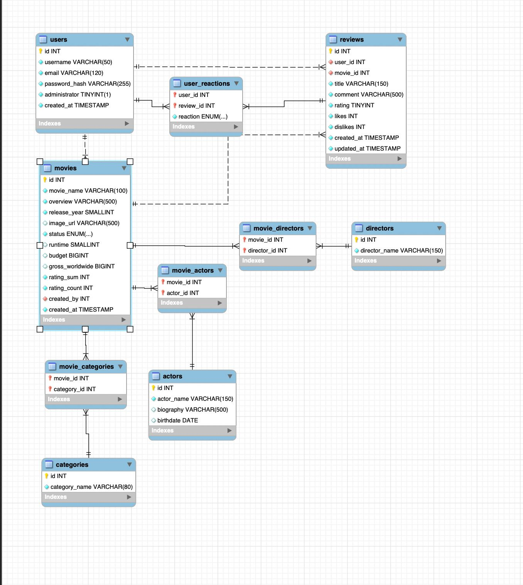

# Carlos Movie Database (CMDB)


PAGINA: srv-dbjb9sou01pc73evgbkg

API para descubrir películas, anime y series geek, publicar reseñas, reaccionar a reseñas y consultar un ranking. El backend usa Node.js, Express y MySQL. El frontend se desarrolla en un repositorio independiente.

Repositorio de esta API: [danielAVAR/cmdb-back-end-](https://github.com/danielAVAR/cmdb-back-end-)

## Documentación

- Video: https://drive.google.com/drive/folders/1XRz8e7SL5ekA93ogKyMmZz5pfo3n3u0U?usp=sharing
- Scrum: https://canva.link/wkx7jp6vim0mi2n
- Historias de usuario: https://canva.link/cagm5h6fnzxndxe

## Requisitos

- Node.js 20 o posterior y npm.
- MySQL 8 o posterior.

## Instalación y ejecución

1. Instala las dependencias con `npm ci`.
2. Copia `.env.example` a `.env` y configura la conexión a MySQL y un secreto JWT aleatorio.
3. Crea las tablas ejecutando `mysql -u <usuario> -p < sql/schema.sql`.
4. Inicia el servidor con `npm run dev`.

La API queda disponible en `http://localhost:3000/api/v1` y Swagger UI en `http://localhost:3000/api-docs`.

## Base de datos



La base de datos MySQL está formada por las siguientes tablas:

- **`users`**: usuarios registrados. El campo `administrator` indica si el usuario tiene permisos de administrador.
- **`movies`**: películas, series o anime. Guarda los datos principales, el `status` (`pending` o aprobado), el usuario que la propuso (`created_by`) y los acumulados para calcular la calificación promedio (`rating_sum` y `rating_count`).
- **`categories`**: categorías de contenido, como acción, anime o terror.
- **`movie_categories`**: tabla intermedia que relaciona películas con categorías. Una película puede tener varias categorías y una categoría puede tener varias películas.
- **`directors`** y **`movie_directors`**: directores y su relación con las películas. Una película puede tener varios directores.
- **`actors`** y **`movie_actors`**: actores, con su biografía y fecha de nacimiento, y su relación con las películas.
- **`reviews`**: reseñas que un usuario publica sobre una película, con título, comentario, calificación del 1 al 10 y contadores de `likes` y `dislikes`.
- **`user_reactions`**: registra la reacción (`like` o `dislike`) que un usuario da a una reseña. Un usuario solo puede reaccionar una vez a cada reseña.

Relaciones principales:

- Un usuario puede proponer muchas películas (`movies.created_by`) y publicar muchas reseñas (`reviews.user_id`).
- Una película puede tener muchas reseñas.
- Un usuario puede reaccionar a muchas reseñas, y una reseña puede recibir reacciones de muchos usuarios, a través de `user_reactions`.
- Las relaciones muchos a muchos entre películas y categorías, directores y actores se resuelven con las tablas intermedias `movie_categories`, `movie_directors` y `movie_actors`.

## Variables de entorno

| Variable | Uso |
| --- | --- |
| `APP_PORT` | Puerto HTTP; por defecto `3000`. |
| `FRONTEND_URL` | Origen permitido por CORS, por ejemplo `http://localhost:5500`. |
| `DB_HOST`, `DB_PORT` | Dirección y puerto de MySQL. |
| `DB_NAME` | Base de datos; por defecto `cmdb`. |
| `DB_USER`, `DB_PASSWORD` | Credenciales de MySQL. |
| `DB_CONNECTION_LIMIT` | Máximo de conexiones del pool. |
| `JWT_SECRET` | Secreto largo y aleatorio para firmar los tokens. |
| `JWT_EXPIRES_IN` | Vigencia del token, por ejemplo `1h` o `7d`. |

No subas `.env` al repositorio.

## Autenticación y permisos

El registro crea usuarios normales. El administrador se representa mediante `users.administrator`; no existe una ruta pública para elevar ese permiso. Para probar rutas administrativas, cambia el valor de ese campo directamente en una base de datos local de desarrollo. El login devuelve un JWT; envíalo como `Authorization: Bearer <token>`.

Las películas nuevas quedan en estado `pending`. Un administrador puede listarlas en `GET /movies/pending` y aprobarlas con `PATCH /movies/:id/approve`. Los usuarios autenticados pueden proponer películas, pero solo quien la creó o un administrador puede editarla o borrarla.

## Rutas principales

Todas las rutas están documentadas y se pueden probar en Swagger UI.

| Método | Ruta | Acceso | Acción |
| --- | --- | --- | --- |
| `POST` | `/auth/register` | Público | Registrar un usuario. |
| `POST` | `/auth/login` | Público | Iniciar sesión y obtener un JWT. |
| `GET` | `/auth/me` | JWT | Consultar el usuario autenticado. |
| `GET`, `GET /:id` | `/categories` | Público | Listar y consultar categorías. |
| `POST`, `PUT /:id`, `DELETE /:id` | `/categories` | Administrador | Administrar categorías. |
| `GET` | `/movies?sort=ranking&categoryId=1` | Público | Listar películas aprobadas, filtrarlas y ordenarlas. |
| `GET /:id` | `/movies` | Público | Consultar detalle, categorías, reparto, dirección y reseñas. |
| `POST`, `PUT /:id`, `DELETE /:id` | `/movies` | JWT | Proponer, editar o eliminar una película según permisos. |
| `GET /pending`, `PATCH /:id/approve` | `/movies` | Administrador | Revisar y aprobar propuestas. |
| `GET /?movieId=1`, `GET /:id` | `/reviews` | Público | Consultar reseñas. |
| `POST`, `PUT /:id`, `DELETE /:id` | `/reviews` | JWT | Crear y administrar reseñas propias. |
| `PUT /:id/reaction`, `DELETE /:id/reaction` | `/reviews` | JWT | Dar o quitar like o dislike a reseñas ajenas. |
| `GET` | `/version` | Público | Consultar la versión de la API. |

Ejemplo de registro:

```http
POST /api/v1/auth/register
Content-Type: application/json

{"username":"ana","email":"ana@example.com","password":"una-clave-segura"}
```

Ejemplo de propuesta de película (requiere JWT):

```json
{
  "movieName": "Ejemplo",
  "overview": "Descripción de la película.",
  "releaseYear": 2025,
  "categoryIds": [1],
  "imageUrl": null
}
```

## Frontend

El frontend independiente se construye con HTML, CSS y JavaScript sin framework. Su URL de repositorio todavía no está definida; agrégala aquí cuando exista.

## Estructura

La documentación en español de cada carpeta está junto a sus archivos, en un `README.md` dentro de la carpeta correspondiente.

## Licencia

ISC.
